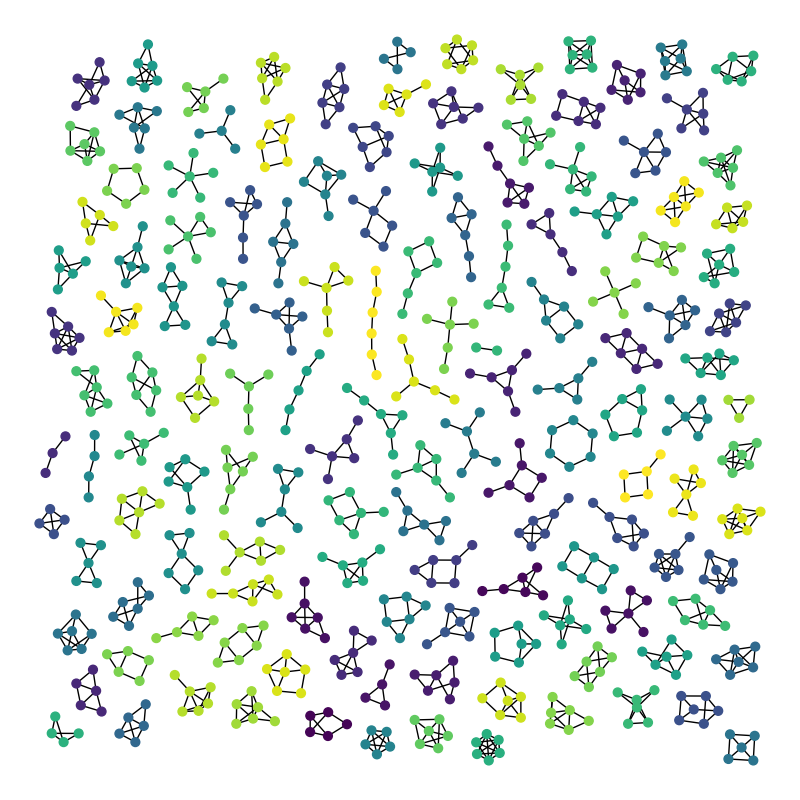

```@meta
EditURL = "../../../src_tutorials/graph_classification.jl"
```

# Graph Classification with Graph Neural Networks

*This tutorial is a Julia adaptation of the Pytorch Geometric tutorial that can be found [here](https://pytorch-geometric.readthedocs.io/en/latest/notes/colabs.html).*



In this tutorial session we will have a closer look at how to apply **Graph Neural Networks (GNNs) to the task of graph classification**.
Graph classification refers to the problem of classifying entire graphs (in contrast to nodes), given a **dataset of graphs**, based on some structural graph properties and possibly on some input node features.
Here, we want to embed entire graphs, and we want to embed those graphs in such a way so that they are linearly separable given a task at hand.
We will use a graph convolutional network to create a vector embedding of the input graph, and the apply a simple linear classification head to perform the final classification.

A common graph classification task is **molecular property prediction**, in which molecules are represented as graphs, and the task may be to infer whether a molecule inhibits HIV virus replication or not.

The TU Dortmund University has collected a wide range of different graph classification datasets, known as the [**TUDatasets**](https://chrsmrrs.github.io/datasets/), which are also accessible via MLDatasets.jl.
Let's import the necessary packages. Then we'll load and inspect one of the smaller ones, the **MUTAG dataset**:

````julia
using Lux, GNNLux
using MLDatasets, MLUtils
using LinearAlgebra, Random, Statistics
using Reactant, Enzyme, Optimisers, OneHotArrays

ENV["DATADEPS_ALWAYS_ACCEPT"] = "true"  # don't ask for dataset download confirmation
Random.seed!(42); # for reproducibility
rng = Xoshiro(42); # for the model parameters and states
````

We compile the model with [Reactant.jl](https://github.com/EnzymeAD/Reactant.jl) and differentiate it with [Enzyme.jl](https://github.com/EnzymeAD/Enzyme.jl).
Reactant runs the compiled programs on a GPU if one is functional, and on the CPU otherwise.
We move data, graphs, parameters and states to the device with `xdev` and bring results back to the host with `cdev`:

````julia
const xdev = reactant_device()
const cdev = cpu_device();

dataset = TUDataset("MUTAG")
````

````
dataset TUDataset:
  name        =>    MUTAG
  metadata    =>    Dict{String, Any} with 1 entry
  graphs      =>    188-element Vector{MLDatasets.Graph}
  graph_data  =>    (targets = "188-element Vector{Int64}",)
  num_nodes   =>    3371
  num_edges   =>    7442
  num_graphs  =>    188
````

````julia
dataset.graph_data.targets |> union
````

````
2-element Vector{Int64}:
  1
 -1
````

````julia
g1, y1 = dataset[1] # get the first graph and target
````

````
(graphs = Graph(17, 38), targets = 1)
````

````julia
reduce(vcat, g.node_data.targets for (g, _) in dataset) |> union
````

````
7-element Vector{Int64}:
 0
 1
 2
 3
 4
 5
 6
````

````julia
reduce(vcat, g.edge_data.targets for (g, _) in dataset) |> union
````

````
4-element Vector{Int64}:
 0
 1
 2
 3
````

This dataset provides **188 different graphs**, and the task is to classify each graph into **one out of two classes**.

By inspecting the first graph object of the dataset, we can see that it comes with **17 nodes** and **38 edges**.
It also comes with exactly **one graph label**, and provides additional node labels (7 classes) and edge labels (4 classes).
However, for the sake of simplicity, we will not make use of edge labels.

We now convert the `MLDatasets.jl` graph types to our `GNNGraph`s and we also onehot encode both the node labels (which will be used as input features) and the graph labels (what we want to predict):

````julia
graphs = mldataset2gnngraph(dataset)
graphs = [GNNGraph(g,
                    ndata = Float32.(onehotbatch(g.ndata.targets, 0:6)),
                    edata = nothing)
            for g in graphs]
y = onehotbatch(dataset.graph_data.targets, [-1, 1])
````

````
2×188 OneHotMatrix(::Vector{UInt32}) with eltype Bool:
 ⋅  1  1  ⋅  1  ⋅  1  ⋅  1  ⋅  ⋅  ⋅  ⋅  1  ⋅  ⋅  1  ⋅  1  ⋅  ⋅  ⋅  ⋅  ⋅  ⋅  ⋅  ⋅  ⋅  ⋅  ⋅  ⋅  ⋅  ⋅  1  ⋅  1  ⋅  1  1  1  ⋅  1  ⋅  ⋅  ⋅  ⋅  ⋅  ⋅  ⋅  ⋅  ⋅  ⋅  ⋅  ⋅  1  ⋅  ⋅  ⋅  ⋅  ⋅  ⋅  1  ⋅  ⋅  1  1  ⋅  ⋅  ⋅  1  ⋅  ⋅  1  ⋅  ⋅  1  1  1  ⋅  ⋅  ⋅  ⋅  ⋅  1  ⋅  ⋅  ⋅  1  1  ⋅  ⋅  ⋅  ⋅  ⋅  ⋅  ⋅  ⋅  1  ⋅  1  ⋅  ⋅  ⋅  ⋅  ⋅  ⋅  ⋅  ⋅  ⋅  1  1  ⋅  1  1  ⋅  1  ⋅  ⋅  1  1  ⋅  ⋅  1  1  ⋅  ⋅  ⋅  ⋅  1  1  1  1  1  ⋅  1  ⋅  ⋅  1  1  ⋅  1  1  1  1  ⋅  ⋅  1  ⋅  ⋅  1  ⋅  ⋅  ⋅  1  1  1  ⋅  ⋅  ⋅  1  ⋅  ⋅  ⋅  ⋅  ⋅  ⋅  ⋅  1  ⋅  ⋅  ⋅  ⋅  ⋅  ⋅  1  ⋅  ⋅  ⋅  1  ⋅  1  1  ⋅  ⋅  1  1  ⋅  1
 1  ⋅  ⋅  1  ⋅  1  ⋅  1  ⋅  1  1  1  1  ⋅  1  1  ⋅  1  ⋅  1  1  1  1  1  1  1  1  1  1  1  1  1  1  ⋅  1  ⋅  1  ⋅  ⋅  ⋅  1  ⋅  1  1  1  1  1  1  1  1  1  1  1  1  ⋅  1  1  1  1  1  1  ⋅  1  1  ⋅  ⋅  1  1  1  ⋅  1  1  ⋅  1  1  ⋅  ⋅  ⋅  1  1  1  1  1  ⋅  1  1  1  ⋅  ⋅  1  1  1  1  1  1  1  1  ⋅  1  ⋅  1  1  1  1  1  1  1  1  1  ⋅  ⋅  1  ⋅  ⋅  1  ⋅  1  1  ⋅  ⋅  1  1  ⋅  ⋅  1  1  1  1  ⋅  ⋅  ⋅  ⋅  ⋅  1  ⋅  1  1  ⋅  ⋅  1  ⋅  ⋅  ⋅  ⋅  1  1  ⋅  1  1  ⋅  1  1  1  ⋅  ⋅  ⋅  1  1  1  ⋅  1  1  1  1  1  1  1  ⋅  1  1  1  1  1  1  ⋅  1  1  1  ⋅  1  ⋅  ⋅  1  1  ⋅  ⋅  1  ⋅
````

We have some useful utilities for working with graph datasets, *e.g.*, we can shuffle the dataset and use the first 150 graphs as training graphs, while using the remaining ones for testing:

````julia
train_data, test_data = splitobs((graphs, y), at = 150, shuffle = true) |> getobs


train_loader = DataLoader(train_data, batchsize = 32, shuffle = true)
test_loader = DataLoader(test_data, batchsize = 32, shuffle = false)
````

````
2-element DataLoader(data::Tuple{Vector{GNNGraphs.GNNGraph{Tuple{Vector{Int64}, Vector{Int64}, Nothing}}}, OneHotArrays.OneHotMatrix{UInt32, Vector{UInt32}}}, batchsize=32)
  with first element:
  (32-element Vector{GNNGraphs.GNNGraph{Tuple{Vector{Int64}, Vector{Int64}, Nothing}}}, 2×32 OneHotMatrix(::Vector{UInt32}) with eltype Bool,)
````

Here, we opt for a `batch_size` of 32, leading to 5 (randomly shuffled) mini-batches, containing all $4 \cdot 32+22 = 150$ graphs.

## Mini-batching of graphs

Since graphs in graph classification datasets are usually small, a good idea is to **batch the graphs** before inputting them into a Graph Neural Network to guarantee full GPU utilization.
In the image or language domain, this procedure is typically achieved by **rescaling** or **padding** each example into a set of equally-sized shapes, and examples are then grouped in an additional dimension.
The length of this dimension is then equal to the number of examples grouped in a mini-batch and is typically referred to as the `batchsize`.

However, for GNNs the two approaches described above are either not feasible or may result in a lot of unnecessary memory consumption.
Therefore, GNNLux.jl opts for another approach to achieve parallelization across a number of examples. Here, adjacency matrices are stacked in a diagonal fashion (creating a giant graph that holds multiple isolated subgraphs), and node and target features are simply concatenated in the node dimension (the last dimension).

This procedure has some crucial advantages over other batching procedures:

1. GNN operators that rely on a message passing scheme do not need to be modified since messages are not exchanged between two nodes that belong to different graphs.

2. There is no computational or memory overhead since adjacency matrices are saved in a sparse fashion holding only non-zero entries, *i.e.*, the edges.

GNNLux.jl can **batch multiple graphs into a single giant graph**:

````julia
vec_gs, _ = first(train_loader)
````

````
(GNNGraphs.GNNGraph{Tuple{Vector{Int64}, Vector{Int64}, Nothing}}[GNNGraph(16, 34) with x: 7×16 data, GNNGraph(11, 22) with x: 7×11 data, GNNGraph(20, 46) with x: 7×20 data, GNNGraph(18, 40) with x: 7×18 data, GNNGraph(17, 38) with x: 7×17 data, GNNGraph(18, 38) with x: 7×18 data, GNNGraph(14, 30) with x: 7×14 data, GNNGraph(16, 36) with x: 7×16 data, GNNGraph(23, 54) with x: 7×23 data, GNNGraph(19, 40) with x: 7×19 data, GNNGraph(22, 50) with x: 7×22 data, GNNGraph(12, 24) with x: 7×12 data, GNNGraph(20, 46) with x: 7×20 data, GNNGraph(10, 20) with x: 7×10 data, GNNGraph(20, 44) with x: 7×20 data, GNNGraph(17, 38) with x: 7×17 data, GNNGraph(13, 28) with x: 7×13 data, GNNGraph(11, 22) with x: 7×11 data, GNNGraph(20, 46) with x: 7×20 data, GNNGraph(20, 46) with x: 7×20 data, GNNGraph(22, 50) with x: 7×22 data, GNNGraph(23, 54) with x: 7×23 data, GNNGraph(21, 44) with x: 7×21 data, GNNGraph(14, 28) with x: 7×14 data, GNNGraph(23, 54) with x: 7×23 data, GNNGraph(24, 50) with x: 7×24 data, GNNGraph(20, 44) with x: 7×20 data, GNNGraph(23, 54) with x: 7×23 data, GNNGraph(19, 44) with x: 7×19 data, GNNGraph(23, 54) with x: 7×23 data, GNNGraph(19, 44) with x: 7×19 data, GNNGraph(23, 54) with x: 7×23 data], Bool[1 1 0 0 0 0 1 0 0 1 0 0 0 1 0 0 1 1 0 0 0 0 0 1 0 0 0 0 0 0 0 0; 0 0 1 1 1 1 0 1 1 0 1 1 1 0 1 1 0 0 1 1 1 1 1 0 1 1 1 1 1 1 1 1])
````

````julia
MLUtils.batch(vec_gs)
````

````
GNNGraph:
  num_nodes: 591
  num_edges: 1316
  num_graphs: 32
  ndata:
    x = 7×591 Matrix{Float32}
````

Each batched graph object is equipped with a **`graph_indicator` vector**, which maps each node to its respective graph in the batch:

```math
\textrm{graph\_indicator} = [1, \ldots, 1, 2, \ldots, 2, 3, \ldots ]
```

## Training a Graph Neural Network (GNN)

Training a GNN for graph classification usually follows a simple recipe:

1. Embed each node by performing multiple rounds of message passing
2. Aggregate node embeddings into a unified graph embedding (**readout layer**)
3. Train a final classifier on the graph embedding

There exists multiple **readout layers** in literature, but the most common one is to simply take the average of node embeddings:

```math
\mathbf{x}_{\mathcal{G}} = \frac{1}{|\mathcal{V}|} \sum_{v \in \mathcal{V}} \mathcal{x}^{(L)}_v
```

GNNLux.jl provides this functionality via `GlobalPool(mean)`, which takes in the node embeddings of all nodes in the mini-batch and the assignment vector `graph_indicator` to compute a graph embedding of size `[hidden_channels, batchsize]`.

The final architecture for applying GNNs to the task of graph classification then looks as follows and allows for complete end-to-end training:

````julia
function create_model(nin, nh, nout)
    GNNChain(GCNConv(nin => nh, relu),
             GCNConv(nh => nh, relu),
             GCNConv(nh => nh),
             GlobalPool(mean),
             Dropout(0.5),
             Dense(nh, nout))
end;

nin = 7
nh = 64
nout = 2
model = create_model(nin, nh, nout)

ps, st = Lux.setup(rng, model) |> xdev;
````

Here, we again make use of the `GCNConv` with $\mathrm{ReLU}(x) = \max(x, 0)$ activation for obtaining localized node embeddings, before we apply our final classifier on top of a graph readout layer.

### Compiling with fixed shapes

Reactant compiles a program for fixed array shapes, and `Lux.Training.single_train_step!` compiles the training step once, on its first call, and reuses it for all subsequent calls.
A mini-batch of graphs, however, has a different number of nodes and edges every time, so it cannot be fed to a training step compiled for another mini-batch.
The general solution is to pad every batch to the same size. Since MUTAG is small, here we simply batch all training graphs (and, separately, all test graphs) into one giant graph and perform full-batch training:

````julia
g_train = MLUtils.batch(train_data[1]) |> xdev
y_train = train_data[2] |> xdev
g_test = MLUtils.batch(test_data[1]) |> xdev
y_test = test_data[2] |> xdev;
````

Let's train our network to see how well it performs on the training as well as test set.
For evaluation, we compile the forward pass in inference mode once for each of the two giant graphs:

````julia
function custom_loss(model, ps, st, (g, x, y))
    logitcrossentropy = CrossEntropyLoss(; logits = Val(true))
    st = Lux.trainmode(st)
    ŷ, st = model(g, x, ps, st)
    return logitcrossentropy(ŷ, y), st, (;)
end

function eval_loss_accuracy(model_compiled, ps, st, g, y)
    ŷ, _ = model_compiled(g, g.x, ps, st)
    ŷ, y = cdev((ŷ, y))
    logitcrossentropy = CrossEntropyLoss(; logits = Val(true))
    return (loss = round(logitcrossentropy(ŷ, y), digits = 4),
            acc = round(mean((ŷ .> 0) .== y) * 100, digits = 2))
end

function train_model(model, ps, st; epochs = 500, infotime = 100)
    st_test = Lux.testmode(st)
    model_train = @compile model(g_train, g_train.x, ps, st_test)
    model_test = @compile model(g_test, g_test.x, ps, st_test)

    function report(epoch, ps, st)
        st = Lux.testmode(st)
        train = eval_loss_accuracy(model_train, ps, st, g_train, y_train)
        test = eval_loss_accuracy(model_test, ps, st, g_test, y_test)
        @info (; epoch, train, test)
    end

    train_state = Training.TrainState(model, ps, st, Adam(1.0f-2))
    report(0, ps, st)
    for epoch in 1:epochs
        _, loss, _, train_state = Training.single_train_step!(AutoEnzyme(), custom_loss,
            (g_train, g_train.x, y_train), train_state)

        epoch % infotime == 0 && report(epoch, train_state.parameters, train_state.states)
    end
    return train_state.parameters, train_state.states
end

ps, st = train_model(model, ps, st);
````

````
[ Info: (epoch = 0, train = (loss = 0.6708f0, acc = 69.33), test = (loss = 0.6849f0, acc = 55.26))
[ Info: (epoch = 100, train = (loss = 0.4564f0, acc = 77.33), test = (loss = 0.5876f0, acc = 73.68))
[ Info: (epoch = 200, train = (loss = 0.4428f0, acc = 78.33), test = (loss = 0.5969f0, acc = 73.68))
[ Info: (epoch = 300, train = (loss = 0.4002f0, acc = 85.33), test = (loss = 0.8212f0, acc = 71.05))
[ Info: (epoch = 400, train = (loss = 0.3546f0, acc = 84.0), test = (loss = 0.7233f0, acc = 75.0))
[ Info: (epoch = 500, train = (loss = 0.3374f0, acc = 85.33), test = (loss = 0.7399f0, acc = 76.32))

````

As one can see, our model reaches around **75% test accuracy**.
Reasons for the fluctuations in accuracy can be explained by the rather small dataset (only 38 test graphs), and usually disappear once one applies GNNs to larger datasets.

## (Optional) Exercise

Can we do better than this?
As multiple papers pointed out ([Xu et al. (2018)](https://arxiv.org/abs/1810.00826), [Morris et al. (2018)](https://arxiv.org/abs/1810.02244)), applying **neighborhood normalization decreases the expressivity of GNNs in distinguishing certain graph structures**.
An alternative formulation ([Morris et al. (2018)](https://arxiv.org/abs/1810.02244)) omits neighborhood normalization completely and adds a simple skip-connection to the GNN layer in order to preserve central node information:

```math
\mathbf{x}_i^{(\ell+1)} = \mathbf{W}^{(\ell + 1)}_1 \mathbf{x}_i^{(\ell)} + \mathbf{W}^{(\ell + 1)}_2 \sum_{j \in \mathcal{N}(i)} \mathbf{x}_j^{(\ell)}
```

This layer is implemented under the name `GraphConv` in GraphNeuralNetworks.jl.

As an exercise, you are invited to complete the following code to the extent that it makes use of `GraphConv` rather than `GCNConv`.
This should bring you close to **82% test accuracy**.

## Conclusion

In this chapter, you have learned how to apply GNNs to the task of graph classification.
You have learned how graphs can be batched together for better GPU utilization, and how to apply readout layers for obtaining graph embeddings rather than node embeddings.

---

*This page was generated using [Literate.jl](https://github.com/fredrikekre/Literate.jl).*

