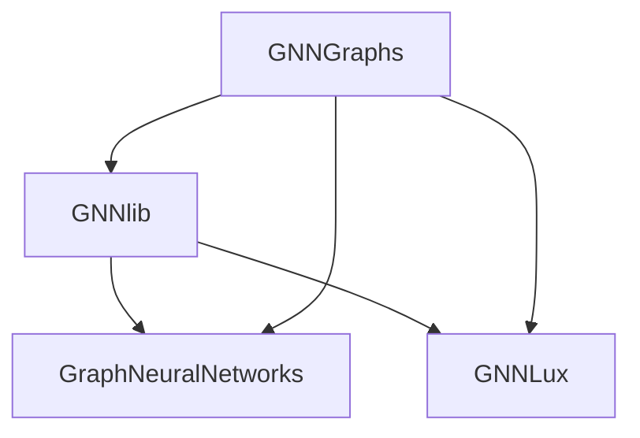

# Developer Notes


## Development Environment
GraphNeuralNetworks.jl is a collection of packages hosted on a single GitHub repository.
These packages are `GraphNeuralNetworks.jl` (a package with the same name as the whole project), `GNNGraphs.jl`, `GNNlib.jl`, and `GNNLux.jl`.

The dependencies between these packages are as follows:


Thanks to [workspaces](https://pkgdocs.julialang.org/v1/toml-files/#The-%5Bworkspace%5D-section) introduced in julia 1.12, developing multiple packages in a monorepo is straightforward.

Clone the repository with
```
git clone https://github.com/JuliaGraphs/GraphNeuralNetworks.jl
```

Then activate any of the packages you want to develop, for example `GraphNeuralNetworks`:
```
cd GraphNeuralNetworks
julia --project=.
```
Dependencies in the monorepo will be automatically available in `dev` mode, so you can start editing the code of any of the packages and test your changes immediately.

## Add a New Layer

To add a new graph convolutional layer and make it available in both the Flux-based frontend (GraphNeuralNetworks.jl) and the Lux-based frontend (GNNLux), you need to:

1. Add the functional version to GNNlib
2. Add the stateful version to GraphNeuralNetworks
3. Add the stateless version to GNNLux
4. Add the layer to the table in docs/api/conv.md

We suggest to start with implementing a self-contained Flux layer in GraphNeuralNetworks.jl, add the corresponding tests, and then when everything is working, move the implementation of the forward pass to GNNlib.jl. At this point, you can add the stateless version to GNNLux.jl.

It could also be convenient to use the `@structdef` macro from [Autostruct.jl](https://github.com/CarloLucibello/AutoStructs.jl) to simultaneously generate the struct and the constructor for the layer.
For example, the Flux implementation of [`MEGNetConv`](@ref) layer can be written as follows:

```julia
using Flux, GraphNeuralNetworks, AutoStructs

@structdef function MEGNetConv(ch::Pair{Int, Int}; aggr = mean)
    nin, nout = ch
    ϕe = Chain(Dense(3nin, nout, relu),
               Dense(nout, nout))

    ϕv = Chain(Dense(nin + nout, nout, relu),
               Dense(nout, nout))

    return MEGNetConv(ϕe, ϕv, aggr)
end

Flux.@layer MEGNetConv

function (l::MEGNetConv)(g::AbstractGraph, x::AbstractMatrix, e::AbstractMatrix)
    ē = apply_edges(g, xi = x, xj = x, e = e) do xi, xj, e
        l.ϕe(vcat(xi, xj, e))
    end
    xᵉ = aggregate_neighbors(g, l.aggr, ē)
    x̄ = l.ϕv(vcat(x, xᵉ))
    return x̄, ē
end
```

## Versions and Tagging
Each PR should update the version number in the Project.toml file of each involved package if needed by semnatic versioning. For instance, when adding new features GNNGraphs could move from "1.17.5" to "1.18.0-DEV". The "DEV" will be removed when the package is tagged and released. Pay also attention to updating
the compat bounds, e.g. GraphNeuralNetworks might require a newer version of GNNGraphs.

## Generate Documentation Locally
Each package has its own documentation folder, e.g. `GNNGraphs/docs`. To generate the docs locally, run the following command from the root of the repository:

```
# example for GNNGraphs
julia --project=GNNGraphs/docs GNNGraphs/docs/make.jl
```

## Benchmarking

You can benchmark the effect on performance of your commits using the script `perf/perf.jl`.

First, checkout and benchmark the master branch:

```julia
julia> include("perf.jl")

julia> df = run_benchmarks()

# observe results
julia> for g in groupby(df, :layer); println(g, "\n"); end

julia> @save "perf_master_20210803_mymachine.jld2" dfmaster=df
```

Now checkout your branch and do the same:

```julia
julia> df = run_benchmarks()

julia> @save "perf_pr_20210803_mymachine.jld2" dfpr=df
```

Finally, compare the results:

```julia
julia> @load "perf_master_20210803_mymachine.jld2"

julia> @load "perf_pr_20210803_mymachine.jld2"

julia> compare(dfpr, dfmaster)
```

## Tutorials

The tutorials are Markdown pages in `docs/src/tutorials/<section>/`, with their images in an `assets/` folder next to them. Their code is in `@example` blocks, so it runs during the docs build. To add a tutorial, add its page there and list it under "Tutorials" in the `pages` of `docs/make.jl`.
