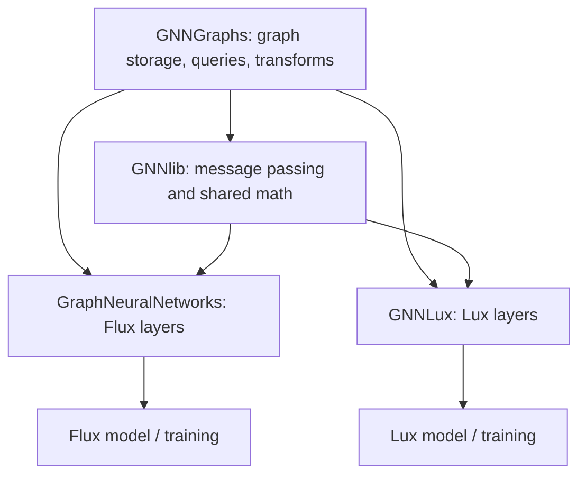
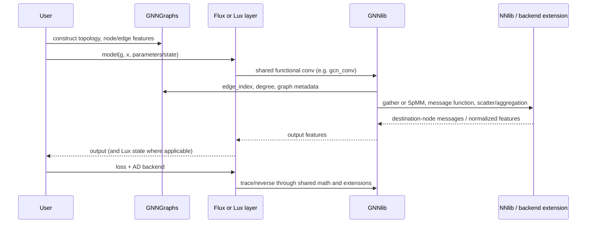

# GraphNeuralNetworks.jl Contributor Research Report

**Audit date:** 2026-11-03 (Asia/Calcutta)  
**Checkout audited:** `master`, `aa2926c` (`Use the registered LuxTestUtils in the GNNLux tests`), tracking `origin/master` at audit start.  
**Scope:** source, package projects, tests, documentation, CI, changelog, and a read-only review of publicly visible GitHub pages. Source files were not edited as part of this audit.  
**Environment:** Windows x64, repo-local Julia 1.13.3. This checkout is a development monorepo: package projects are `-DEV` and the local workspace resolves sibling packages by path.

## 1. Executive summary

This is a four-package Julia monorepo. `GNNGraphs` owns graph structures and data operations; `GNNlib` owns message passing and functional layer math; `GraphNeuralNetworks` provides stateful Flux layers; and `GNNLux` provides stateless Lux layers. The frontends re-export the graph and message-passing APIs so most users need only select Flux or Lux.

The best first contribution is a small test or documentation change in one subsystem, then an edge-case fix with a regression test. The repository has a meaningful test suite based on `TestItemRunner`, separate CPU and accelerator filters, and an established three-layer implementation pattern for new convolutions. Do not begin by editing all four layers at once: first reproduce the behavior in a test, find which package owns it, then follow the repository's layer workflow in `GraphNeuralNetworks/docs/src/dev.md` and `AGENTS.md`.

One current, concrete investigation is [issue #710](https://github.com/JuliaGraphs/GraphNeuralNetworks.jl/issues/710): a reported Reactant compilation error for Lux `GCNConv`, traced in the issue to degree/scatter handling. The report's stack and the local source path agree, but this audit did **not** independently reproduce it: Reactant is not in the repository's test environments and the issue was reported on Apple Silicon while this machine is Windows x64. Treat the reported trace as a high-quality reproduction from the reporter, not as a local run.

No other new correctness bug was established by static inspection. Several explicit limitations and test gaps are recorded below as opportunities, not defects. All four package CPU suites passed; the initial GNNGraphs run hit a sandbox-blocked Cora data download, then passed on retry with network access. See §12 for exact counts and broken-item notes.

## 2. Repository overview

The four package versions in the checkout are `GNNGraphs 1.6.0-DEV`, `GNNlib 1.4.1-DEV`, `GNNLux 0.3.0-DEV`, and `GraphNeuralNetworks 1.1.1-DEV`, taken from their package `Project.toml` files. The root `Project.toml` is a Julia workspace manifest, not a fifth registered package. Each package has its own dependency and compatibility declarations. `Manifest.toml` is ignored by Git; the local setup created an ignored manifest and package cache, neither of which is part of the source audit.

The isolated test environment used for the audit resolved Julia 1.13.3, Graphs 1.15.0, Flux 0.16.15, Lux 1.31.5, NNlib 0.9.57, MLUtils 0.4.15, Zygote 0.7.15, Enzyme 0.13.216, Mooncake 0.5.67, and LuxTestUtils 2.3.2. These are this machine's resolved test versions, not package compat minima. Searching the checked-in source/projects finds no Reactant dependency or extension, which is why #710 was not directly executable in the repository test environment.

Top-level source/configuration areas are `.buildkite`, `.github`, `docs`, `GNNGraphs`, `GNNlib`, `GNNLux`, and `GraphNeuralNetworks`. Repository guidance is in `AGENTS.md`, `CLAUDE.md`, `README.md`, `CHANGELOG.md`, and `.JuliaFormatter.toml`. The checkout also has local setup additions from the preceding development-tools task (`DEVELOPMENT.md`, `scripts/`, `.tools/`, `.julia-depot/`); the latter two are ignored, generated local dependencies and are excluded from the codebase tree below.

## 3. Complete source tree (generated files and binaries omitted)

```text
.
├── .buildkite/pipeline.yml
├── .github
│   ├── dependabot.yml
│   └── workflows
│       ├── multidocs.yml
│       ├── TagBot.yml
│       ├── test_GNNGraphs.yml
│       ├── test_GNNlib.yml
│       ├── test_GNNLux.yml
│       └── test_GraphNeuralNetworks.yml
├── docs
│   ├── Project.toml
│   ├── logo.svg
│   └── make-multi.jl
├── GNNGraphs
│   ├── Project.toml, README.md, LICENSE
│   ├── docs/{Project.toml,make.jl,src/{index.md,api/{datasets,gnngraph,heterograph,temporalgraph}.md,guides/{datasets,gnngraph,heterograph,temporalgraph}.md}}
│   ├── ext/{GNNGraphsCUDAExt,GNNGraphsEnzymeCoreExt,GNNGraphsMooncakeExt,GNNGraphsSimpleWeightedGraphsExt}.jl
│   ├── src/{GNNGraphs.jl,abstracttypes.jl,chainrules.jl,convert.jl,datastore.jl,deprecations.jl,gatherscatter.jl,generate.jl,gnngraph.jl,mldatasets.jl,operators.jl,query.jl,sampling.jl,temporalsnapshotsgnngraph.jl,transform.jl,utils.jl}
│   │   └── gnnheterograph/{generate,gnnheterograph,query,transform,utils}.jl
│   └── test/{Project.toml,runtests.jl,test_module.jl,chainrules.jl,convert.jl,datastore.jl,enzyme.jl,generate.jl,gnngraph.jl,gnnheterograph.jl,mldatasets.jl,operators.jl,query.jl,sampling.jl,temporalsnapshotsgnngraph.jl,transform.jl,utils.jl,ext/{Mooncake,SimpleWeightedGraphs}.jl}
├── GNNlib
│   ├── Project.toml, README.md, LICENSE
│   ├── docs/{Project.toml,make.jl,src/{index.md,api/{messagepassing,utils}.md,guides/messagepassing.md}}
│   ├── ext/{GNNlibAMDGPUExt,GNNlibCUDAExt,GNNlibMetalExt,GNNlibMooncakeExt}.jl
│   ├── src/{GNNlib.jl,msgpass.jl,utils.jl,layers/{basic,conv,pool,temporalconv}.jl}
│   └── test/{Project.toml,runtests.jl,test_module.jl,msgpass.jl,utils.jl}
├── GNNLux
│   ├── Project.toml, README.md, LICENSE
│   ├── docs/{Project.toml,make.jl,make_tutorials.jl,src/{index.md,api/{basic,conv,pool,temporalconv}.md,guides/models.md,tutorials/{beginner_tutorials/{gnn_intro,graph_classification,node_classification}.md,intermediate_tutorials/traffic_prediction.md},assets/{logo.svg,schema.png}},src_tutorials/{gnn_intro,graph_classification,node_classification,traffic_prediction}.jl}
│   ├── src/{GNNLux.jl,layers/{basic,conv,pool,temporalconv}.jl}
│   └── test/{Project.toml,runtests.jl,test_module.jl,layers/{basic,conv,pool,temporalconv}.jl}
├── GraphNeuralNetworks
│   ├── Project.toml, README.md, LICENSE
│   ├── docs/{Project.toml,make.jl,synthetic_datasets.jl,old_tutorials/{make_tutorials_literate,make_tutorials_pluto,temporal_graph_classification}.jl,src/{index.md,dev.md,api/{basic,conv,heteroconv,pool,temporalconv}.md,guides/models.md,tutorials/{beginner_tutorials/{gnn_intro,graph_classification,node_classification}.{md},intermediate_tutorials/traffic_prediction.md},assets/{logo.svg,logo.png,schema.png,logo_alternatives/V1.svg…V10.svg}}}
│   ├── examples/{Project.toml,graph_classification_temporalbrains.jl,graph_classification_tudataset.jl,link_prediction_pubmed.jl,neural_ode_cora.jl,node_classification_cora.jl,traffic_prediction.jl}
│   ├── notebooks/{gnn_intro,graph_classification,graph_classification_solved}.ipynb
│   ├── perf/{Project.toml,bench_gnn.jl,neural_ode_mnist.jl,node_classification_cora_geometricflux.jl,perf.jl,sparse_propagate_cuda.jl,perf_master_20210830_carlodsba.jld2}
│   ├── src/{GraphNeuralNetworks.jl,deprecations.jl,layers/{basic,conv,heteroconv,pool,temporalconv}.jl}
│   └── test/{Project.toml,runtests.jl,test_module.jl,examples/node_classification_cora.jl,layers/{basic,conv,heteroconv,pool,temporalconv}.jl}
├── .JuliaFormatter.toml, .git-blame-ignore-revs, .gitignore, AGENTS.md, CHANGELOG.md, CLAUDE.md, codecov.yml, LICENSE, Project.toml, README.md
└── Local development additions: DEVELOPMENT.md, scripts/{julia,setup-dev}.ps1
```

The tree groups files with repeated naming into braces for readability; each listed group corresponds to the files actually present at the audited checkout. Documentation images, notebooks, and the `.jld2` benchmark snapshot are assets/data, not Julia source. `docs/build`, local manifests, binary downloads, and Julia caches are generated/ignored content and deliberately omitted.

## 4. Folder-by-folder explanation

| Folder | Responsibility and dependencies | Main entry points |
|---|---|---|
| `.github/workflows` | CPU package test workflows, docs builds, release tagging. These define CI behavior, not package runtime. | `test_*.yml`, `multidocs.yml`, `TagBot.yml` |
| `.buildkite` | Accelerator jobs executed on CUDA/ROCm hardware queues. Depends on Buildkite agents and JuliaCI plugins. | `pipeline.yml` |
| `docs` | Builds the combined documentation landing site after each package docs site. | `make-multi.jl`, `Project.toml` |
| `GNNGraphs/src` | Graph types, feature stores, graph queries, transformations, generation, sampling, conversion. Used by all other packages. | `GNNGraph`, `GNNHeteroGraph`, `degree`, `edge_index`, `batch`, `propagate` helpers |
| `GNNGraphs/ext` | Optional CUDA, Enzyme, Mooncake, and SimpleWeightedGraphs integrations loaded through Julia package extensions. Depends on weak dependencies rather than making them mandatory. | extension modules in `Project.toml` |
| `GNNGraphs/test` | Graph representation, algorithms, transforms, AD, optional backend tests. Provides shared fixtures and tagged test items. | `runtests.jl`, `test_module.jl` |
| `GNNGraphs/docs` | Public API and guides for homogeneous, heterogeneous, and temporal graph features. | `make.jl`, `src/api`, `src/guides` |
| `GNNlib/src` | Framework-neutral message passing, functional convolution/pooling/recurrent math, graph and tensor utilities. Depends on GNNGraphs, NNlib, MLUtils, and numeric utility packages. | `propagate`, `apply_edges`, `aggregate_neighbors`, `layers/*.jl` |
| `GNNlib/ext` | Optional backend-specific message passing and Mooncake rules. | `GNNlibCUDAExt`, `GNNlibAMDGPUExt`, `GNNlibMetalExt`, `GNNlibMooncakeExt` |
| `GNNlib/test` | Tests functional propagation, utilities, graph types and AD paths. | `msgpass.jl`, `utils.jl`, `test_module.jl` |
| `GNNLux/src` | Lux's stateless layer structs, parameter/state initialization, calls into GNNlib. Depends on both lower layers and Lux APIs. | `GNNLux.jl`, `layers/*.jl` |
| `GNNLux/test` | Layer output, shape, and AD tests using LuxTestUtils; current `runtests.jl` explicitly says GPU test coverage is not yet added. | `layers/*.jl`, `test_module.jl` |
| `GNNLux/docs` | Lux API pages and authored beginner/intermediate tutorials; `src_tutorials` are source examples used to generate tutorial pages. | `make_tutorials.jl`, `make.jl` |
| `GraphNeuralNetworks/src` | Flux frontend. Layer structs, trainable parameter definitions, recurrence/container behavior, hetero layer support. | `GraphNeuralNetworks.jl`, `layers/*.jl` |
| `GraphNeuralNetworks/test` | Flux layer, graph-to-layer integration, CPU/GPU and AD tests, one example smoke/training item. | `layers/*.jl`, `test_module.jl` |
| `GraphNeuralNetworks/examples`, `notebooks` | Runnable user examples and interactive workflows. Example environments have their own projects. | node/graph/link classification, temporal traffic, neural ODE |
| `GraphNeuralNetworks/perf` | Benchmarks and historical comparison artifacts. Not part of the package's runtime path. | `perf.jl`, `bench_gnn.jl`, `sparse_propagate_cuda.jl` |
| `GraphNeuralNetworks/docs` | Flux API, developer guide, tutorials, datasets used for documentation, historical tutorial-generation scripts. | `make.jl`, `src/dev.md` |
| `scripts` | Local Windows PowerShell bootstrap and Julia launcher added during the prior setup task. Not part of upstream package runtime. | `setup-dev.ps1`, `julia.ps1` |

## 5. Important file-by-file explanation

### Repository-level files

| File | Role |
|---|---|
| `Project.toml` | Root Julia workspace; lists child projects. It has no package UUID or root library module. |
| `AGENTS.md` | Repository architecture, supported Julia version, test commands, test item conventions, GPU backend settings, layer development steps, changelog/version rules. Read before coding. |
| `CLAUDE.md` | Agent-specific contributor notes. |
| `README.md` | User-facing overview, package selection, install examples, citation. |
| `CHANGELOG.md` | Single chronological release history for four independently versioned packages; useful for checking already-completed bug fixes. |
| `.JuliaFormatter.toml` | Selects SciML formatter style. |
| `.gitignore` | Excludes local manifests, build outputs and local development environments; also excludes `.tools/` and `.julia-depot/` added during setup. |
| `codecov.yml` | Coverage reporting configuration. |
| `.git-blame-ignore-revs` | Lists formatting-only revisions to omit during blame. |
| `DEVELOPMENT.md`, `scripts/*.ps1` | Repo-local Windows Julia setup; they do not affect package source. |

### Package files

| Path(s) | Key responsibilities |
|---|---|
| `GNNGraphs/src/GNNGraphs.jl` | Module imports/includes and public exports. Good starting point for the graph package API. |
| `GNNGraphs/src/abstracttypes.jl` | `AbstractGNNGraph{T}` subtype of Graphs.jl's `AbstractGraph{Int}` and representation type aliases. |
| `GNNGraphs/src/gnngraph.jl` | `GNNGraph` constructor, metadata, graph storage, `ndata`/`edata`/`gdata`, `num_nodes`, `num_edges`, `num_graphs`. |
| `GNNGraphs/src/datastore.jl` | `DataStore` dictionary-like feature storage and property/indexing interface. It stores arbitrary feature arrays in a `Dict{Symbol,Any}`, so callers must respect observation count conventions. |
| `GNNGraphs/src/gnnheterograph/gnnheterograph.jl` | Heterogeneous relation storage keyed by `(source type, relation, destination type)` and per-node-type features. |
| `GNNGraphs/src/temporalsnapshotsgnngraph.jl` | `TemporalSnapshotsGNNGraph`, sequence of homogeneous graph snapshots plus temporal graph data. |
| `GNNGraphs/src/query.jl`, `gnnheterograph/query.jl` | Edge access, degree, adjacency/Laplacian, type, batch indicator, directedness and heterograph queries. |
| `GNNGraphs/src/transform.jl`, `gnnheterograph/transform.jl` | Self-loop and edge transforms, coalescing, batching/unbatching, node removal, graph extraction, diffusion and edge splitting. |
| `GNNGraphs/src/generate.jl`, `gnnheterograph/generate.jl` | Random, bipartite, k-nearest-neighbor, radius, and temporal graph generation. |
| `GNNGraphs/src/convert.jl` | Conversion among COO, adjacency matrix, graph library and sparse forms. |
| `GNNGraphs/src/gatherscatter.jl` | Internal recursive gather/scatter adapters that map over tuple/named-tuple/dict feature payloads and delegate arrays to NNlib. |
| `GNNGraphs/src/sampling.jl` | Neighbor sampling and `NeighborLoader` integration. |
| `GNNGraphs/src/mldatasets.jl` | Conversion helpers from MLDatasets graph data. |
| `GNNGraphs/src/chainrules.jl` | ChainRules custom derivatives and non-differentiable declarations for graph operations. |
| `GNNGraphs/src/operators.jl`, `utils.jl`, `deprecations.jl` | Graph operators, feature normalization/checking, helper algorithms, and compatibility aliases. |
| `GNNlib/src/GNNlib.jl` | Module exports and include order for utilities, message passing, layers and pooling. |
| `GNNlib/src/msgpass.jl` | `propagate` pipeline plus message helpers and graph-specialized fast paths. |
| `GNNlib/src/utils.jl` | Node/edge reduction, graph-wise and neighbor-wise softmax, graph/edge broadcasting. |
| `GNNlib/src/layers/conv.jl` | Functional math for spatial convolutions; this is where shared forward-pass correctness should be fixed. |
| `GNNlib/src/layers/basic.jl` | Basic decoder math and layer primitives. |
| `GNNlib/src/layers/pool.jl` | Graph-level pooling functions and Set2Set/TopK helpers. |
| `GNNlib/src/layers/temporalconv.jl` | Shared cell math for temporal graph convolution/recurrent models. |
| `GraphNeuralNetworks/src/GraphNeuralNetworks.jl` | Flux imports, re-exports GNNGraphs/GNNlib, includes and exports Flux frontend layers. |
| `GraphNeuralNetworks/src/layers/basic.jl` | `GNNLayer`, `GNNChain`, `WithGraph`, decoder, Flux chain integration. |
| `GraphNeuralNetworks/src/layers/conv.jl` | Mutable/trainable Flux layer structs, constructors, display, calls into `GNNlib.*_conv`. |
| `GraphNeuralNetworks/src/layers/heteroconv.jl` | Relation-specific modules and aggregation into heterogeneous destination node types. |
| `GraphNeuralNetworks/src/layers/pool.jl` | Flux graph pooling layer wrappers. |
| `GraphNeuralNetworks/src/layers/temporalconv.jl` | Flux temporal sequence/recurrent wrappers calling shared GNNlib math. |
| `GNNLux/src/GNNLux.jl` | Lux imports, re-export of GNNGraphs, include/export list. |
| `GNNLux/src/layers/basic.jl` | Lux container and chain abstractions. |
| `GNNLux/src/layers/conv.jl` | `@concrete` layer definitions, `initialparameters`, parameter length, Lux `(y, st)` calls into GNNlib. |
| `GNNLux/src/layers/pool.jl`, `temporalconv.jl` | Lux pooling and sequence/cell layers. |
| `*/ext/*.jl` | Optional package extensions activated by weak dependencies; backend code belongs here where it is backend-specific. |
| `*/test/runtests.jl` | `TestItemRunner` runner; untagged items are CPU, `:gpu` items are selected by environment variables. |
| `*/test/test_module.jl` | Shared fixtures and backend/device/gradient test helpers. Review these before writing a new test. |
| `*/docs/make.jl`, `*/docs/Project.toml` | Package documentation dependency environment and Documenter build entrypoint. |
| `GraphNeuralNetworks/examples/Project.toml`, `perf/Project.toml` | Isolated dependency environments for examples and benchmark scripts. |

### Configuration and dependency files

There are 16 checked-in `Project.toml` files: root workspace; four package projects; four package test environments; four package docs environments; the combined docs project; and the examples and performance environments. Each package project declares `[deps]`, `[weakdeps]`, `[extensions]`, and `[compat]`; test-only packages such as Enzyme, Mooncake, TestItemRunner and LuxTestUtils belong in test environments, not in core runtime dependencies. `Manifest.toml` is not a tracked lockfile here.

`.github/dependabot.yml` updates GitHub Actions and Julia dependencies weekly. The four `test_*.yml` workflows test each package on Ubuntu with Julia 1.10 and latest stable Julia. `.buildkite/pipeline.yml` runs CUDA and AMDGPU jobs on hosted hardware queues. `.github/workflows/multidocs.yml` builds each package's docs plus the combined site; `.github/workflows/TagBot.yml` tags each registered package separately, required because the root is a workspace without a package UUID.

## 6. Architecture and package responsibilities



| Package | Responsibility and public surface | Why separate it / where to change |
|---|---|---|
| **GNNGraphs** | `GNNGraph`, `GNNHeteroGraph`, `TemporalSnapshotsGNNGraph`, `DataStore`; graph query, convert, batch, transform, sampling, generation, feature gather/scatter. | Keeps graph structures usable without choosing Flux or Lux. Put graph representation, degree, graph mutation or batching changes here. Public exports are in `GNNGraphs/src/GNNGraphs.jl:21-125`. |
| **GNNlib** | `propagate`, `apply_edges`, `aggregate_neighbors`, built-in message functions; functional convolution, temporal and pool functions; reductions/softmax. | Shared math avoids duplicate forward formulas across frontends. Put backend-agnostic layer math and message-passing optimization here. Public exports are in `GNNlib/src/GNNlib.jl:17-74`. |
| **GraphNeuralNetworks** | Flux trainable layers and containers; re-exports GNNGraphs/GNNlib. | Flux stores trainable arrays in layer structs. Update its wrapper/constructor, trainability and tests when exposing a shared functional layer to Flux. |
| **GNNLux** | Lux layers implementing parameter/state initialization and Lux call convention; re-exports GNNGraphs. | Lux passes explicit `ps`/`st`, unlike Flux's stateful layer object. Update this wrapper plus tests/docs when a layer should be available to Lux. |

The function crossing the package boundary is typically `GNNlib.gcn_conv(layer, graph, x, ...)`: the frontend owns the layer shape, trainable parameter representation, activation and state convention; GNNlib owns feature propagation and output math; GNNGraphs owns topology and degree/edge queries; NNlib supplies dense/scatter/sparse tensor primitives; extensions specialize implementation for optional accelerators/AD systems.

## 7. Important functions, types and algorithms

### Graph representations and dimensions

`GNNGraph` (see `GNNGraphs/src/gnngraph.jl:107+`) represents edges as source and target node indices `(s,t)` in COO, or a dense/sparse adjacency matrix. Node features have nodes in the **last** axis, usually `features × nodes`; edge features use `features × edges`. Edge index values are one-based Julia indices. Adjacency matrices in this repository follow `A[source,target]` for directed edges, so distinguish source and target orientation when changing a reduction. An optional third COO tuple entry stores edge weights. The `is_coalesced` bit records canonical target-then-source ordering and no duplicate edges; optimized paths may depend on it.

`GNNHeteroGraph` stores relation-specific edge-index/weight data and per-type feature stores, keyed with symbols. Its `num_nodes`/`num_edges` values are dictionaries, not scalar counts. `TemporalSnapshotsGNNGraph` is a vector of `GNNGraph` snapshots, not a single graph with a time axis; the model decides how recurrent state flows over snapshots.

`DataStore` provides `g.ndata.x`, `g.edata.e`, and `g.gdata.u` access. The store uses `Dict{Symbol,Any}` because a feature store may contain unrelated array shapes and names. Construction/set operations check observation count when a count is known; tests are in `GNNGraphs/test/datastore.jl`.

### Message passing

`apply_edges` (`GNNlib/src/msgpass.jl:117-128`) checks feature dimensions, gets `(s,t)`, gathers target/root features `xi` with `t` and source/neighbour features `xj` with `s`, then calls a user message function `f(xi,xj,e)`. `aggregate_neighbors` (`:145-156`) scatters edge messages back to destination nodes (`t`). `propagate` (`:71-79`) composes these operations. Named tuples/tuples/dicts of arrays are recursively mapped by GNNGraphs' `_gather` and `_scatter` adapters.

For `E` edges and `F` feature values per edge, generic gather/message/scatter work is approximately `O(EF)` and materializes edge-sized gathered arrays (space `O(EF)`, before the output). GNNlib specializes common message patterns such as `copy_xj`, `e_mul_xj`, and `w_mul_xj` to matrix multiplication/sparse propagation where supported, avoiding some per-edge intermediate storage. For performance changes, benchmark both coalesced and uncoalesced graphs and account for backend-specific sparse support.

### Degree and scatter

`Graphs.degree(::GNNGraph{<:COO_T}, ...)` in `GNNGraphs/src/query.jl:337-353` resolves weights, determines a result element type, and delegates to `_degree`. COO `_degree` at `:378-392` builds unweighted ones if needed, zeros of length `num_nodes`, then calls `NNlib.scatter(+, edge_weight, s/t)` for out/in directions. Work is linear in edges plus nodes; memory is `O(V)` output plus backend scatter temporaries. Matrix `_degree` at `:394-402` sums adjacency rows/columns. The `:both` path sums both directions and therefore counts a self-loop in each direction; this is the documented degree convention in tests.

The `degree` tests in `GNNGraphs/test/query.jl:66-207` cover unweighted/weighted directed graphs, graph representations, gradients, and GPU tagged paths. Existing `broken = ...` annotations document known representation-specific expectations. Metal explicitly skips gather/scatter degree GPU tests at `:178` pending support. Do not infer a defect from those documented skips.

### Convolution layers

| Layer | Math/shape behavior and code location | Test location |
|---|---|---|
| `GCNConv` | Shared function `GNNlib/src/layers/conv.jl:14-79`; frontend structs/calls `GraphNeuralNetworks/src/layers/conv.jl:77-105`, `GNNLux/src/layers/conv.jl:84-141`. Adds optional self-loops, degree-normalizes source and destination features, sums transformed neighbour messages, applies weight/bias/activation. It may multiply by `W` before propagation when `out < in` to reduce work, otherwise after. External edge weights require COO; adjacency external weights explicitly throw. Default normalization is inverse square-root degree. | `GraphNeuralNetworks/test/layers/conv.jl:7-75`; `GNNLux/test/layers/conv.jl:10-24`; degree tests above. |
| `GATConv` | `GNNlib/src/layers/conv.jl:112-167`; Flux struct starts `GraphNeuralNetworks/src/layers/conv.jl:309`; Lux starts `GNNLux/src/layers/conv.jl:860`. Projects node/optional edge features per head, computes LeakyReLU attention scores, neighbor softmax, attention-weighted aggregation, then head concatenation/averaging and activation. | Flux tests `:154-192`; Lux `GNNLux/test/layers/conv.jl:59-70`. |
| `GATv2Conv` | GNNlib `:171-218`; parameterized attention order makes attention dynamic with features. Frontends begin Flux `:413`, Lux `:1000`. | Flux `:194-232`; Lux `:71-81`. |
| `NNConv` | GNNlib `:258-278`; edge network emits a per-edge matrix, reshaped to `(out,in,edges)`, applied by `NNlib.batched_mul`, then aggregated. Cost includes the per-edge generated matrices: roughly `O(E·in·out)` storage/work plus the edge MLP. | Flux `:301-325`; Lux `:112-127`. |
| `MEGNetConv` | GNNlib `:362+`; edge MLP updates using `(xi,xj,e)`, edge messages aggregate to nodes, node MLP updates `(x, aggregated edge features)`. Returns updated node and edge features in the Flux interface. | Flux `:427-458`; Lux `:99-110`. |
| `GraphConv`, `GINConv`, `SAGEConv`, `EdgeConv`, `CGConv`, `GMMConv`, `EGNNConv`, `ResGatedGraphConv`, `AGNNConv`, `ChebConv`, `DConv`, `SGConv`, `TAGConv`, `TransformerConv`, `GatedGraphConv` | Functional math is grouped by layer heading in GNNlib `src/layers/conv.jl`; wrapper definitions are similarly headed in the two frontend `conv.jl` files. Read the docstring/formula and the matching `@testitem` before changing a layer. | Flux `GraphNeuralNetworks/test/layers/conv.jl`; Lux `GNNLux/test/layers/conv.jl`. |

Complexity depends on graph format and backend. Generic message passing scales with edges; dense adjacency multiplication may scale with `V²`; sparse matrix multiplication scales with nonzeros plus feature width. Do not claim an optimization without benchmarking representative graph sizes and `:coo`, `:dense`, `:sparse` where supported.

### Pooling, batch, temporal and heterogeneous functions

- `global_pool` and `global_attention_pool` aggregate node features using `graph_indicator`; graph-wise output has one column per graph. `topk_index`/`topk_pool` select nodes by learned scores. `set2set_pool` uses a recurrent query/readout. Functional implementations are in `GNNlib/src/layers/pool.jl`; wrappers/tests are in each frontend `layers/pool.jl` and `test/layers/pool.jl`.
- `MLUtils.batch` combines graph index sets with node-index offsets and a graph-indicator vector; `unbatch` reconstructs per-graph pieces. See `GNNGraphs/src/transform.jl:675-799` and test roundtrips in `GNNGraphs/test/transform.jl:23-130`. Zero-edge cases matter; a historical bug was fixed in PR #652 and is called out in the release notes.
- `HeteroGraphConv` applies typed relation submodules and reduces their outputs by destination node type (`GraphNeuralNetworks/src/layers/heteroconv.jl:42-90`). Relation and node type dictionary keys must be preserved through batching and transfer.
- Temporal layers split a cell (one time step) from a recurrence (sequence), so test both cell state and full sequence. Flux recurrent layers are in `GraphNeuralNetworks/src/layers/temporalconv.jl`; shared formula functions are in GNNlib temporalconv. Lux's temporal wrappers live in `GNNLux/src/layers/temporalconv.jl`. `TGCN` activation support was already added (CHANGELOG entry for PR #596), so it is not a new contribution target.

### Multiple dispatch, extensions and autodiff

Julia chooses a method from argument types, not just a method name. This repo relies on that for graph representation dispatch (`GNNGraph{<:COO_T}` vs adjacency matrices), scalar/vector edge weights, feature payload containers, Flux/Lux layer calls, and backend arrays. Search for all methods of a shared function before editing it. Package extensions are declared in `[weakdeps]` and `[extensions]`: they let the package specialize CUDA/AMDGPU/Metal or AD behavior only when that package is loaded.

AD support is part of the API surface: ChainRules rules live in GNNGraphs, Mooncake specializations in `GNNGraphs/ext` and `GNNlib/ext`, and EnzymeCore extension rules in GNNGraphs. Flux tests compare AD gradients to finite differences/Zygote/Mooncake in helper code; Lux tests use LuxTestUtils. Shape tests plus gradient consistency do not prove a forward formula is mathematically correct—there are explicit numeric/reference tests for selected formulas, such as DConv in `GraphNeuralNetworks/test/layers/conv.jl:622-661`.

## 8. End-to-end GNN execution flow



For a simple sum-aggregation layer, with source `j` sending to target `i`, the conceptual operations are `m[j→i] = f(x_i,x_j,e_{ji})` followed by `x'_i = φ(□_{j∈N(i)} m[j→i])`. In GCN, each message is degree-normalized and linear feature transform, then summed. Graph construction fixes edge direction and counts; GNNlib relies on GNNGraphs' `edge_index` and `degree`; frontend code supplies parameters and activation; AD differentiates the exact path chosen by NNlib/backend methods.

## 9. Confirmed bugs

### C-710 — Reactant `GCNConv` compilation fails in reported environment

- **Severity:** Medium (backend-specific failure; normal CPU and Zygote path reportedly work).
- **Status:** Confirmed as a current public issue with a minimal reporter-provided reproduction; **not reproduced on this audit machine**.
- **Evidence:** [Issue #710](https://github.com/JuliaGraphs/GraphNeuralNetworks.jl/issues/710) remains open in the page opened on 2026-11-03, is labeled `gnnlib`/`lux`, reports GNNLux 0.2.0, GNNGraphs 1.5.1, Reactant 0.2.285, Julia 1.12.6 on Apple Silicon CPU, and shows `Ops.scatter` receiving `Vector{Vector{Reactant.TracedRNumber{Float32}}}` where its nearest methods expect vectors of `TracedRArray`. The page says no linked branch/PR.
- **Local path:** `GNNLux/src/layers/conv.jl:128-140` delegates to `GNNlib.gcn_conv`; `GNNlib/src/layers/conv.jl:42-57` asks GNNGraphs for degree; `GNNGraphs/src/query.jl:337-353` dispatches COO degree; `:378-390` creates unweighted edge values and uses `NNlib.scatter` for incoming/outgoing degrees; `GNNGraphs/src/gatherscatter.jl:12-18` is the separate graph message scatter adapter. The failing operation named in the issue is the degree scatter (`NNlib.scatter` / Reactant `Ops.scatter`), not the neighbor-message scatter in GNNlib's message-passing stage.
- **Why package ownership matters:** graph degree and construction of degree inputs are GNNGraphs responsibilities; shared convolution calls are GNNlib; Lux wrapper only enters the shared path. A generic, array-type-preserving graph fix belongs first in GNNGraphs if confirmed; a Reactant-only dispatch/rule could belong in a separate extension if core arrays already preserve types correctly. Do not patch the Lux layer just to hide a lower-level traced scalar representation.
- **Why the vector element type appears:** the report states the runtime has materialized edge weights/updates as ordinary nested vectors of traced scalar values, while the scatter method accepts array-valued traced updates. The local `_degree` source routes edge values through `ones_like(s,T)` and NNlib scatter. Static inspection establishes this path but does not establish exactly which `ones_like`/Reactant lowering step creates the nested vectors; determine that with a debugger or minimal instrumented Reactant reproducer before proposing a code change.
- **Edge weights:** COO stores optional weights as the third component of `g.graph`; `get_edge_weight(g)` returns it (`GNNGraphs/src/query.jl:16`). For default unweighted GCN, `use_edge_weight=false` asks degree for unweighted counts; edge weights can also be supplied or stored in the graph. The issue's stack indicates a traced scalar vector even in its no-external-edge-weight example.
- **Reproduction/expectation:** use the issue's code verbatim in the same package versions/device. Expected: `@compile model(g,x_d,ps_d,st_d)` returns a compiled function and executes; reported actual: `MethodError` in scatter. Local attempt was not run because Reactant is absent from all repo test projects and platform differs.
- **Regression tests:** graph-level `degree` on Reactant arrays for unweighted COO and weighted COO; test `dir=:in`, `:out`, and `:both`; test isolated node and empty edge set if supported; then Lux `GCNConv` compilation with default normalization and self-loops. Add separate tests for graph-stored and explicit edge weights. Keep CPU result and Zygote gradient behavior covered. Any Reactant test should be an explicit optional/extension CI job, not a hard dependency of default CPU test suites.
- **Possible solutions/tradeoffs:** (1) make core degree's identity updates/zeros stay array-shaped under traced arrays (best if the minimal reproducer shows `ones_like`/`zeros_like` is the source; benefits any backend, but must preserve CPU/GPU AD); (2) add a narrow optional Reactant extension method or adaptation for scatter (isolates dependency, but adds extension maintenance and version-compat burden); (3) alter the convolution to avoid the degree scatter (may duplicate graph logic and not solve `degree` generally). The first two require a minimal proof and maintainer agreement; no speculative fix was applied.

## 10. Potential bugs and hypotheses

No independent static-review finding met the evidence bar for a separate bug. The issue page #710 is the only bug report in this audit with a specific trace and local source path.

These are **investigation leads**, not verified failures:

1. Check Reactant traced arrays through all graph constructors and `GNNGraphs.degree` overloads, not only GCN; issue #710 stack establishes the GCN case only.
2. Check zero-edge and empty-relation behavior for heterograph `GATConv` gradients, corresponding to public issue #637 (its current state must be checked directly before work; search results can be stale).
3. Check AD through `GNNGraphs.add_edges` after issue #671 reports a Zygote segfault; do not infer it is still open/failing merely from an indexed issue list.
4. Check SGConv repeated-training runtime against a benchmark and memory profile before calling it a leak; issue #603 is a report, not proof of current failure.

For each lead, use a minimal test, reproduce on a clean environment, inspect matching tests/history/PRs and then record actual/expected behavior. Do not classify an issue label or TODO as an independently confirmed bug.

## 11. Performance, compatibility and quality observations

| Category | Verified observation | Interpretation |
|---|---|---|
| Performance | Generic GNNlib message passing gathers `xi/xj` per edge, computes messages and scatters (`GNNlib/src/msgpass.jl:121-155`). | `O(EF)` edge data is expected for the generic path. Fast paths and graph-format tradeoffs should be measured; this is not itself a defect. |
| Performance | `Graphs.degree(g, i)` currently computes a whole degree vector before indexing and is tagged `# TODO:: Make efficient` (`GNNGraphs/src/query.jl:356-357`). | Concrete local optimization candidate; benchmark repeated/sparse selections and preserve exact semantics. |
| Compatibility | External GCN edge-weight vectors are explicitly rejected for adjacency-matrix graph types (`GNNlib/src/layers/conv.jl:3-4`). | Documented implementation limit; not a bug. A feature request would need define duplicate-edge semantics and conversion cost. |
| Accelerator | Metal degree test skips gather/scatter pending backend support (`GNNGraphs/test/query.jl:174-179`). | Known backend gap; confirm current Metal extension capabilities before claiming unsupported operations beyond this path. |
| Lux coverage | `GNNLux/test/runtests.jl:17` says no GPU tests are added; CPU tests use LuxTestUtils. | Coverage gap/opportunity, not evidence all Lux GPU code fails. |
| AD coverage | Flux helpers compare AD output and finite differences; comments record selective Mooncake skips and upstream issues in temporal tests. | AD compatibility needs be reported per backend/layer/graph representation. A passing test on one backend is not universal proof. |
| Source parity | Flux exports `TAGConv` and `TransformerConv`; current GNNLux export list omits them (and the file comments them out at `GNNLux/src/GNNLux.jl`). | API parity opportunity only. First inspect implementation state and design intent before porting. |
| Type flexibility | `DataStore` stores arbitrary arrays as `Any` values in a symbol dictionary. | Deliberate heterogeneous feature-store design. Profile before proposing a specialized container. |

Prior fixes in `CHANGELOG.md` are valuable regression context: zero-edge batch unbatch (#652), empty edge-neighbor softmax (#636), graph mutation/self-loop bugs (#659), GPU scalar indexing (#691/#672), GMMConv formula (#645), and DConv formula (#693). Check changelog and blame before reopening similar work.

## 12. Test and CI analysis

### How tests are structured

Tests use `@testitem` and `TestItemRunner`, not only nested `@testset`. `test/runtests.jl` filters out `:gpu` items when `GNN_TEST_CPU` defaults to `true`; GPU variables select those tagged items. Graph fixture setup lives in package `test_module.jl`. In the GNNGraphs/Flux/GNNlib harnesses, CUDA is paired with cuDNN and scalar indexing is disabled; AMDGPU and Metal are loaded on demand. Lux has its own `TestModuleLux` and LuxTestUtils gradient helper.

The ordinary package commands and per-package coverage are:

```powershell
.\scripts\julia.ps1 --project=GNNGraphs -e 'using Pkg; Pkg.test("GNNGraphs")'
.\scripts\julia.ps1 --project=GNNlib -e 'using Pkg; Pkg.test("GNNlib")'
.\scripts\julia.ps1 --project=GraphNeuralNetworks -e 'using Pkg; Pkg.test("GraphNeuralNetworks")'
.\scripts\julia.ps1 --project=GNNLux -e 'using Pkg; Pkg.test("GNNLux")'
```

CI runs these on Ubuntu with Julia 1.10 and current stable; tests for Flux/GNNlib/GNNGraphs/GNNLux are separate. Buildkite is the GPU path: CUDA and AMDGPU queues for GNNGraphs, GNNlib, and Flux frontend. Metal tests are locally selectable by environment variable but are not in the checked-in Buildkite matrix. The docs workflow builds four package sites and then the combined site. The Julia version in the docs workflow is pinned separately (currently 1.12.2 in this checkout, with an inline note about moving it after a Pkg fix).

Coverage exists across graph constructors, transforms, queries, message passing, convolution, pooling, temporal layers and AD. Gaps/opportunities: Reactant isn't included in a project/test environment; Lux's GPU suite is not implemented; no CI matrix for Metal; a few generic paths are intentionally skipped/broken by graph type/backend. Those facts should be stated per operation and backend, not summarized as “GPU unsupported.”

### Audit test run

**Initial command:** `.\scripts\julia.ps1 --project=GNNGraphs -e 'using Pkg; Pkg.test("GNNGraphs")'` on Julia 1.13.3, repo-local environment. Result: **1,348 passed, 1 error, 8 broken/expected-broken**, total 1,357; runtime 5m28.7s. The sole error was `mldataset2gnngraph` in `GNNGraphs/test/mldatasets.jl`: it could not fetch `https://github.com/kimiyoung/planetoid/raw/master/data/ind.cora.x` because the sandbox blocked GitHub.

**Network-enabled retry:** same command with authorized network access. Result: **1,352 passed, 8 broken/expected-broken**, total 1,360; runtime 4m16s; `Pkg.test` reported the suite passed. The extra four checks came from the formerly blocked dataset item.

The eight `Broken` outcomes are TestItems' explicitly declared broken cases, not eight newly diagnosed defects. No GPU tests were requested/executed. Tests were run because the audit request explicitly asked for appropriate non-destructive checks. No source edits were made by test execution.

**GNNlib:** `.\scripts\julia.ps1 --project=GNNlib -e 'using Pkg; Pkg.test("GNNlib")'` on Julia 1.13.3. Result: **86 passed, 0 failures/errors**, runtime 1m29.6s; `Pkg.test` reported success.

**GraphNeuralNetworks (Flux):** `.\scripts\julia.ps1 --project=GraphNeuralNetworks -e 'using Pkg; Pkg.test("GraphNeuralNetworks")'` on Julia 1.13.3. Result: **928 passed, 0 failures/errors**, runtime 14m48.2s; `Pkg.test` reported success. The full run includes the CPU Cora training example.

**GNNLux:** `.\scripts\julia.ps1 --project=GNNLux -e 'using Pkg; Pkg.test("GNNLux")'` on Julia 1.13.3. Result: **177 passed, 2 broken/expected-broken**, total 179; `Pkg.test` reported success. LuxTestUtils emitted “No backends to test. Skipping test...” warnings for autodiff checks where no backend is configured; these were warnings, not suite failures.

The four package CPU suites passed. GPU suites and documentation builds were not run. Tests were run because the audit request explicitly asked for appropriate non-destructive checks. No source edits were made by test execution.

### Running a single test item

The repo instructions recommend the Julia VS Code test-item UI. From the repository root, TestItemRunner also supports a name filter without editing a tracked runner:

```powershell
.\scripts\julia.ps1 --project=GNNGraphs/test -e 'using TestItemRunner; TestItemRunner.run_tests("GNNGraphs/test"; filter = ti -> ti.name == "degree")'
.\scripts\julia.ps1 --project=GraphNeuralNetworks/test -e 'using TestItemRunner; TestItemRunner.run_tests("GraphNeuralNetworks/test"; filter = ti -> ti.name == "GCNConv")'
```

Search exact names/paths first with `rg -n '@testitem' GNNGraphs/test GraphNeuralNetworks/test`. The filter name is the string in `@testitem`, not the filename. Shared fixture modules are discovered by TestItemRunner.

## 13. Existing issues, pull requests and opportunities

Web access was available, but GitHub's repository issue and pull-request list pages returned stale snapshots (roughly two to three months old), while direct issue #710 and #669 pages were current through 2026-11-02. The PR list snapshot showed 23 open/444 closed and included PR #703 as open, but the local changelog/release notes record #703 as merged; GitHub refused to load the individual PR pages due cache misses. This directly demonstrates why the list cannot be represented as current. Consequently this is a curated issue/PR discovery snapshot, **not a guaranteed exhaustive live list**. The issue #710 page says no development branch or linked PR; the repo's current local `CHANGELOG.md` records already merged fixes through PRs #722, #718, #707, #706, #704 and others. Always refresh each issue/PR page and `git log` before adopting it.

| Type | Candidate | Evidence and contribution guidance |
|---|---|---|
| Public open issue | [#710 Reactant GCNConv compile error](https://github.com/JuliaGraphs/GraphNeuralNetworks.jl/issues/710) | Current direct issue page, no linked PR. Strong intermediate/advanced reproducer and test opportunity; see §9. |
| Public newcomer label | [#640 Mooncake CPU compatibility](https://github.com/JuliaGraphs/GraphNeuralNetworks.jl/issues/640) | Direct page still says open/good-first-issue and records 16/20 spatial conv layers checked at an earlier point. Status is a useful entry point, but its scope may have changed since replies; ask maintainers what remains. |
| Public issue lead | [#702 Mooncake CUDA issue tracker](https://github.com/JuliaGraphs/GraphNeuralNetworks.jl/issues/702) | Appears open in indexed results; inspect current issue and active PR before selecting CUDA work. |
| Public issue lead | [#637 GATConv on heterographs with empty edges/backprop](https://github.com/JuliaGraphs/GraphNeuralNetworks.jl/issues/637) | Appears open in indexed results; candidate regression tests around empty relations and gradient paths. |
| Public issue lead | [#671 `add_edges` Zygote segfault](https://github.com/JuliaGraphs/GraphNeuralNetworks.jl/issues/671) | Appears open in indexed results; verify current Julia/Zygote version and reproduce first. |
| Public issue lead | [#603 SGConv runtime growth](https://github.com/JuliaGraphs/GraphNeuralNetworks.jl/issues/603) | Appears open in indexed results; profile across training iterations and allocator behavior before proposing a fix. |
| Public issue lead | [#600 batching gradients](https://github.com/JuliaGraphs/GraphNeuralNetworks.jl/issues/600) | Appears open in indexed results; tests should isolate batch/unbatch and Zygote rather than assume graph construction itself fails. |
| Public feature lead | [#609 COO matrix support](https://github.com/JuliaGraphs/GraphNeuralNetworks.jl/issues/609) | Appears open in indexed results; define supported COO semantics/operations and compare sparse/COO backend behavior. |
| Resolved/closed; do not repeat | [#669 Link Prediction tutorial proposal](https://github.com/JuliaGraphs/GraphNeuralNetworks.jl/issues/669) | Direct page shows closed Nov 2, 2026 (one completed/not-planned activity); not an open contribution slot. Existing `examples/link_prediction_pubmed.jl` also covers link prediction. |
| Resolved in code; do not repeat | [#591 TGCN activation](https://github.com/JuliaGraphs/GraphNeuralNetworks.jl/issues/591) | Search page status is stale, but current changelog records TGCN nonlinear activations merged in #596 and implementation accepts `act`; verify GitHub status before referencing it. |

Recent public release notes list PRs #701–#722 era fixes/features, including #703 Enzyme graph conversion, #704 GNNGraphs Mooncake extension, #706 Enzyme scaled-Laplacian rule, #707 recurrence inputs for Enzyme, #718 GPU edge-weight propagation, and #722 AMDGPU scaled Laplacian fix. These entries demonstrate active backend/AD work; they are not unmerged contribution opportunities. The public 2026 GSoC project “Improving Automatic Differentiation Support and Performance for GraphNeuralNetworks.jl” already addressed Mooncake and Enzyme, so avoid proposing that same work as novel without identifying a remaining scope.

### Fifteen+ proposed contribution opportunities

These are **my proposed work**, not maintainer-approved issues. Check for duplicate PRs first.

| Level / idea | Relevant code; skills and effort | Tests, impact and GSoC fit |
|---|---|---|
| Beginner: add exact expected-value tests for an under-covered graph query | `GNNGraphs/src/query.jl`, `GNNGraphs/test/query.jl`; Julia `@testitem`, directed graph semantics; low. | Small hand-constructed COO/dense/sparse graphs, isolated node and duplicate-edge cases. Good first PR; not GSoC alone. |
| Beginner: improve graph direction and feature-dimension guide | `GNNGraphs/docs/src/guides/gnngraph.md`, `GNNlib/docs/src/guides/messagepassing.md`; Markdown, tensor axes; low. | Run docs build. Helps prevent common source/target/last-axis mistakes. |
| Beginner: document graph batch/unbatch zero-edge behavior | `GNNGraphs/src/transform.jl`, tests and API guide; graph batching; low. | Roundtrip checks for zero-edge/empty graph in mixed batches. Good first PR if a precise doc/test gap remains. |
| Beginner: add a minimal Lux link-prediction example | `GNNLux/docs`, examples or new tutorial source; Lux state, losses and edge split; low-medium. | Use deterministic tiny graph, disjoint train/eval edges; build docs. GSoC contribution component, not proposal alone. |
| Beginner: clearer argument validation/error tests for feature counts | `GNNGraphs/src/utils.jl`, `gnnheterograph/utils.jl`, matching tests; Julia exceptions/dispatch; low. | Assert stable exception type/message for node/edge mismatch. Useful maintenance. |
| Beginner: document optional GPU setup and backend coverage | package READMEs/docs + `.buildkite/pipeline.yml`; Julia extensions; low. | Check CPU/default and optional backend paths. Clarify per-backend support. |
| Intermediate: resolve remaining CPU Mooncake compatibility gaps | `GNNlib/src/layers/*.jl`, extensions and layer tests; reverse-mode AD, chain rules; medium. | Per-layer finite-difference comparison across COO/sparse then AD. Coordinate with #640/current maintainers. |
| Intermediate: Reactant GCN degree/scatter compatibility | `GNNGraphs/src/query.jl`, maybe new extension, GNNLux GCN tests; array wrappers/compiler tracing; medium-high. | Minimal degree reproducer then full Lux GCN compile, weighted/unweighted. Directly related to #710, GSoC subproject. |
| Intermediate: add GNNLux GPU tests for representative layers | `GNNLux/test`, `test_module.jl`, CI backend matrix; Lux state and GPU memory movement; medium. | Start GCN + pooling on one supported device, no scalar indexing. Broader CI reliability. |
| Intermediate: benchmark and optimize indexed `degree(g, nodes)` | `GNNGraphs/src/query.jl:356-357`; scatter and allocation profiling; medium. | Compare against full degree for repeated/single indices, all semantics/representations; performance PR. |
| Intermediate: port a missing Flux layer to Lux after confirming API intent | `GNNLux/src/layers/conv.jl`, `GNNLux/src/GNNLux.jl`, tests/docs; Lux containers and parameter trees; medium. | Match Flux behavior and gradient expectations; check commented exports and parity discussion first. |
| Intermediate: heterograph empty-edge attention regression fixes | `GNNlib/src/layers/conv.jl`, GNNGraphs hetero query, frontend tests; typed relation reductions; medium. | Zero-edge relation plus reverse-mode; coordinate with #637. |
| Advanced: design a general Reactant graph-operation extension | `GNNGraphs/ext`, `GNNlib/ext`, CI; Reactant tracing/StableHLO/compiler constraints; high. | Multi-operation device test matrix and CPU correctness; possible GSoC-scale theme if maintainers agree. |
| Advanced: sparse message-passing performance study | `GNNlib/src/msgpass.jl`, CUDA/AMDGPU extensions, `GraphNeuralNetworks/perf`; sparse linear algebra/GPU profiling; high. | Benchmark graph density, coalescing, feature width and gradients, report memory too. Could expand into research project. |
| Advanced: AD rules for additional optimized SpMM paths | `GNNlib/ext/GNNlibMooncakeExt.jl`, message-pass tests; reverse rules and sparse matrix calculus; high. | Compare primal and gradients to generic edge path and finite differences on CPU/CUDA. Relevant to active AD area. |
| Advanced: cross-backend empty graph and heterogeneous operator contract | GNNGraphs, GNNlib, extensions, CI; dispatch and accelerator kernels; high. | Backend-specific edge cases and type invariants; broad reliability/GSoC candidate only after scoped proposal. |
| Intermediate: add a benchmark baseline for GNNLux stateful training | `GraphNeuralNetworks/perf`, Lux examples; BenchmarkTools, model state; medium. | Compare identical Flux/Lux model, include warmup and allocations, avoid claiming speed without repeatable data. |

For each proposal, the actual “expected impact” is a hypothesis until users/maintainers validate it. Avoid changing compatibility bounds, public API or package version without following the repo's SemVer/changelog practices.

## 14. Contributor workflow (Windows PowerShell)

This checkout already has local, isolated Julia setup scripts. For a fresh fork/clone:

```powershell
git clone https://github.com/<your-user>/GraphNeuralNetworks.jl.git
cd GraphNeuralNetworks.jl
git remote add upstream https://github.com/JuliaGraphs/GraphNeuralNetworks.jl.git
git remote -v
.\scripts\setup-dev.ps1
```

For an existing fork, add `upstream` once and sync before a task:

```powershell
git fetch upstream
git switch master
git pull --ff-only upstream master
git switch -c fix/short-description
```

Use the repo-local launcher and package tests:

```powershell
.\scripts\julia.ps1 --project=GNNGraphs -e 'using Pkg; Pkg.test("GNNGraphs")'
.\scripts\julia.ps1 --project=GNNlib -e 'using Pkg; Pkg.test("GNNlib")'
.\scripts\julia.ps1 --project=GraphNeuralNetworks -e 'using Pkg; Pkg.test("GraphNeuralNetworks")'
.\scripts\julia.ps1 --project=GNNLux -e 'using Pkg; Pkg.test("GNNLux")'
# Optional: CUDA tests after a GPU backend is available/configured
$env:GNN_TEST_CPU = 'false'; $env:GNN_TEST_CUDA = 'true'
.\scripts\julia.ps1 --project=GraphNeuralNetworks -e 'using Pkg; Pkg.test("GraphNeuralNetworks")'
# Docs and formatter
.\scripts\julia.ps1 --project=GraphNeuralNetworks/docs GraphNeuralNetworks/docs/make.jl
.\scripts\julia.ps1 --project=.tools/devtools -e 'using JuliaFormatter; format(".")'
```

Before editing, use `rg -n "name_or_symbol"` to find implementation, exports, tests, docs, and similar frontend copies. For a new convolution, the repo guide's sequence is: prototype/test Flux layer; move backend-independent forward math into GNNlib; add Lux wrapper; add docs table entry. The graph/layer feature axis is last, which is often different from dense neural-network examples in other frameworks.

For a bug PR, include the smallest failing test first, explain expected and observed behavior, include test command/results in the PR, and note CPU/GPU/AD versions. Use focused commits with meaningful messages; no checked-in contribution guide adds a special commit convention. The repository changelog asks user-facing fixes/features to be added under the package's latest/Unreleased heading with the PR reference; bump affected package versions/compat when SemVer requires it. Push your branch to your fork, open a PR against upstream `master`, describe package(s), tests, behavior change and limitations, then respond to review with follow-up commits and re-run relevant suites. Avoid rewriting shared history after review unless maintainers request it. Before finalizing, `git status`, `git diff --check`, and inspect your diff for accidental generated files.

## 15. GSoC 2027 preparation

GSoC 2027 project availability, organization acceptance, mentor availability and selection are unknown. The Julia organization accepted a 2026 graph-neural-network project around AD performance and compatibility, which is useful historical context but does not promise the same project will exist in 2027. The official Julia GSoC page is [here](https://www.julialang.org/jsoc/gsoc/gnn/); the 2026 project description is on [Google's archive](https://summerofcode.withgoogle.com/programs/2026/projects/ZEaHtnWu).

### Good starting areas

Begin with GNNGraphs constructors/query/transform or a narrow test/documentation task; then learn GNNlib's message passing and Flux/Lux wrappers. Existing AD tests and changelog entries provide concrete examples of mature contribution work. Public maintainer names visible in issues include Carlo Lucibello and recent contributors in the corresponding package areas; use issue discussions/PR reviews to identify who is active for a specific topic, and ask on the public issue rather than assuming mentor assignment.

### Three possible project directions

| Proposal direction | Difficulty / impact | Prerequisites and milestones |
|---|---|---|
| **Reactant support for graph message passing** | Advanced; could enable compiler-oriented execution across an important GNN path. | Learn Julia dispatch, Reactant arrays/ops and graph gather/scatter. Milestones: reproduce #710; map operation compatibility; implement one minimal array-shape fix or extension; add degree + GCN tests; broaden to GAT/pooling only if feasible; document unsupported operations and benchmark. |
| **AD correctness/coverage matrix for Flux and Lux** | Intermediate-to-advanced; gives contributors/users reliable layer/backend expectations. | Understand finite differences and reverse rules. Milestones: inventory layer × graph type × AD backend; add expected-value checks where gradient consistency is insufficient; resolve one concrete issue (e.g. remaining #640 scope); add optional CI selection; publish a compatibility table. |
| **Scalable sparse message-passing performance** | Advanced; potential memory/throughput improvements on sparse and accelerator graphs. | Sparse linear algebra, GPU profiling, algorithmic complexity. Milestones: establish reproducible baselines; identify dominant path; optimize one kernel/fast path; add exact parity/gradient checks; document crossover conditions and limitations. |

### Proposal preparation checklist and timeline

Use the 30/60/90-day plan in `docs/CONTRIBUTION_ROADMAP.md`. A strong proposal should identify a maintainer-confirmed scope, cite current issues/PRs, show a working small PR, state baseline measurements or reproducer, break work into testable milestones, describe risks/fallbacks and specify mentorship/check-in cadence. Do not claim a proposal is accepted or available until the organization publishes its 2027 project list.

## 16. Learning resources

- Repository architecture and commands: `AGENTS.md`, `GraphNeuralNetworks/docs/src/dev.md`, package READMEs.
- Graph APIs and representations: `GNNGraphs/docs/src/guides/gnngraph.md`, `heterograph.md`, `temporalgraph.md`.
- Message passing: `GNNlib/docs/src/guides/messagepassing.md` and `api/messagepassing.md`.
- Layer API/tutorials: `GraphNeuralNetworks/docs/src/api/`, `GNNLux/docs/src/api/`, beginner tutorials.
- Julia package and dispatch basics: [Julia manual](https://docs.julialang.org/en/v1/), [Pkg documentation](https://pkgdocs.julialang.org/), and Julia package extension docs linked from Julia's manual.
- Scientific graph neural networks: repository's JMLR paper, [GraphNeuralNetworks.jl: Deep Learning on Graphs with Julia](https://www.jmlr.org/papers/v26/24-2130.html).
- Current open-source context: issue pages linked in §13; always reload before proposing work because public search snapshots can lag.

## 17. Glossary

| Term | Meaning here |
|---|---|
| COO | Coordinate graph representation: source and target integer vectors, optionally followed by edge weights. |
| Sparse/dense graph | Adjacency matrix representation, with different operation and duplicate-edge behavior from COO. |
| `xi` / `xj` | Target/root-node and source/neighbour features, respectively, after edge materialization. |
| Message passing | Compute a per-edge message, then aggregate incoming messages to destination nodes. |
| Scatter | Add/update edge-aligned values into an output indexed by destination node (or graph). |
| Gather | Select node/graph values using edge/node indices. |
| Coalesced | COO edges are canonicalized and duplicates removed/combined, enabling certain fast paths. |
| Batch graph | Multiple independent graphs represented as one disconnected graph plus graph membership indicators. |
| Heterograph | Graph with typed node sets and typed relations; features and counts are per type. |
| Lux `ps`, `st` | Explicit model parameters and non-parameter state passed into/out of a Lux layer. |
| Weak dependency / extension | Optional package dependency that activates specialized methods only when loaded. |
| Multiple dispatch | Julia selects a method from the types of all arguments, allowing graph/backend-specific implementations. |
| AD | Automatic differentiation; gradient support depends on the exact operation and backend path. |
| Reactant | Julia package that traces/compiles numerical Julia programs to accelerator/compiler execution; its traced array/scalar types affect dispatch. |
| `@testitem` | Independent named test block discovered and run by TestItemRunner. |
| DEV version | Unreleased development version suffix used by this monorepo before a package is tagged. |

